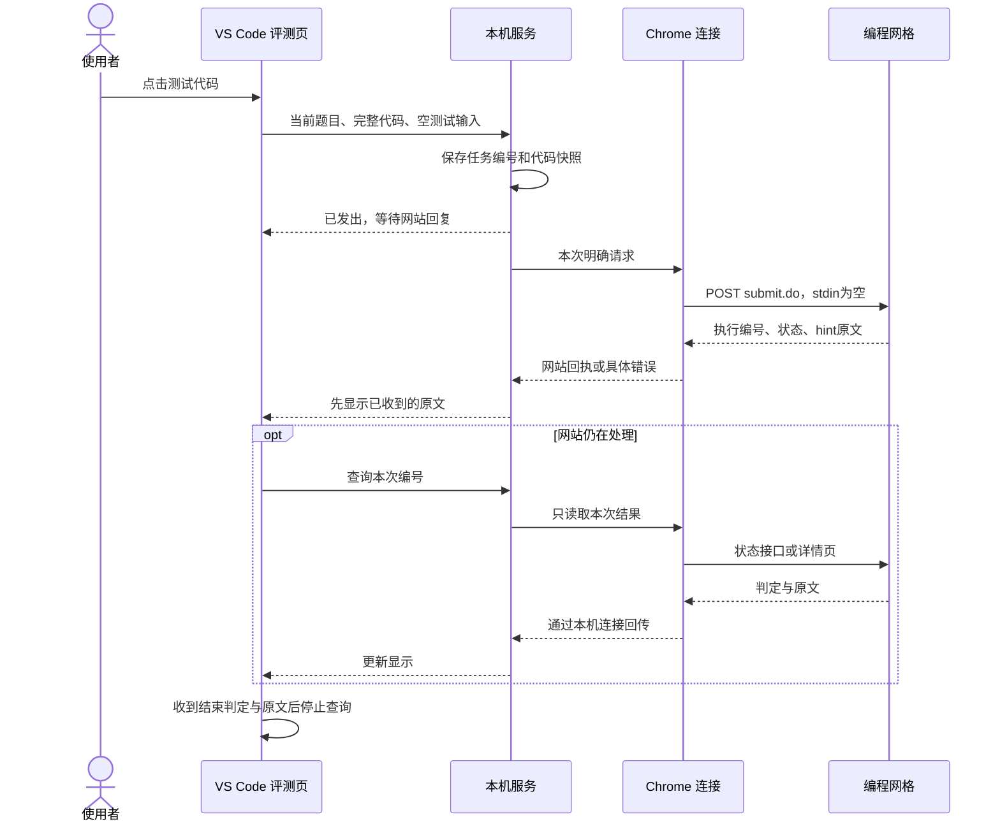

# 编程网格适配：架构与数据流

本工具把“运行与判题”和“AI 学习辅助”分成两个入口。前者由编程网格返回真实结果；后者根据题目、代码及已保存证据提供学习建议。

## 组件职责

| 组件 | 负责什么 | 主要文件 |
| --- | --- | --- |
| VS Code 扩展 | 读取当前 C++ 缓冲区，提供按钮、题面及两个独立页面 | `vscode-extension/extension.cjs`、`judge-window.html`、`judge-controls.js` |
| 本机服务 | 校验题目关联、保存请求和结果、快速返回任务状态 | `src/vscode-host.js`、`src/vscode-service.js` |
| 本机浏览器连接 | 在本机文件信箱与 Chrome Native Messaging 之间转发 | `src/browser-mailbox.js`、`src/oj-native-host.js`、`native/launcher.cpp` |
| Chrome 扩展 | 找到同一道题的 IDE 标签，以已登录会话调用网站 | `extension/grid-worker.js`、`extension/grid-submit.js` |
| 编程网格 | 编译、执行、判题并提供原文 | 网站的 `submit.do`、`solution/<编号>/status.do` 与详情页 |
| 分析进程 | 保存学习过程，生成提示、交流答复及报告 | `src/hint-review.js`、`src/model-runner.js` 等 |

“本机程序”像中转站：VS Code 不能直接使用 Chrome 的登录会话，Chrome 也不能任意读取 VS Code 的未保存代码。中转站把用户本次明确点击的代码和题目地址送到浏览器，再将网站回复带回来。

## 一次测试怎样运行



本机保存和后台报告处理不阻挡已收到的原文。查询结果只针对原请求的编号和快照；编辑器后来修改代码，不会改变旧任务所代表的代码。

## 空字段与缺省字段的差别

同一个接口可以通过参数表达不同操作。当前网站行为由网页脚本和使用者在 Network 中提供的真实表单共同核对：

| 操作 | `sourceCode` | `programLanguage` | `type` | `stdin` |
| --- | --- | --- | --- | --- |
| 网页原生测试 | 本次代码 | `C++` | `json` | 存在，值为空 |
| 手工输入测试 | 本次代码 | `C++` | `json` | 存在，值为自定义输入 |
| 正式提交 | 本次代码 | `C++` | `json` | 不发送 |

空值表示“这个字段存在，但没有自定义输入”；缺省表示“这次请求没有这个字段”。两者不能合并处理。之前自动把题目样例填入测试请求，使默认测试变成手工运行；现在默认始终发送空字段，只有用户启用可选手工模式才发送输入框内容。

## 原文、状态和结束条件

- 执行编号是网站返回的字符串，实际出现过 32 位十六进制编号；只校验它是安全的地址片段，不假定纯数字。
- 网站 `hint` 是 IDE 输出与提示的主要原文。界面保留换行，不拆造网站没有单独给出的标准答案或用例。
- 外层 `Processing` 表示仍在处理。`Testing` 可能是已经完成的测试类型；若原文有 `Result: WrongAnswer` 等明确判定，按该判定显示。手工运行的 `Complete! Please check the output by yourself` 只表示执行结束。
- 完整名称与颜色显示在原文上方。Empty Output 等具体网站状态保留其含义，不强行统一显示为 WA 缩写。
- 详情页可以补充反馈。已经收到结束判定与原文时，不为了补读详情页反复刷新；较慢的状态接口也不会挡住已返回的详情原文。
- 当前操作最多进行有限次数的结果查询；查询暂停后可主动刷新。恢复历史只读本机记录，不重新启动网站查询。
- 原始接口 JSON 仍可保存在本机记录，用户页面只呈现网站原文、判定和必要提示。

旧版本留下的 `Testing + pending` 记录，在已有完成原文时会在本机改正状态。这个修正不重新上传代码。

## 失败时发生什么

浏览器请求在注入脚本内部捕获异常，并作为可序列化数据返回。这样可以避免脚本 Promise 失败后，Chrome 只留下一个没有结果的执行记录。回传可包含失败阶段、错误文字及已收到的原文。

本机连接记录“已转发”“Chrome 已接收”“已找到题目标签”“等待网站接口”等阶段；文件通知之外另有定期扫描，减少漏收请求。网站接口等待有期限，超时后保留不确定状态，不自动重复发送。明确在发送前发现题目不匹配时，显示未发送。

“已建立连接”不等于网站已经处理请求；“首次回复”也不等于最终评测完成。排查时先看当前题目和本次编号，再看网站原文和失败阶段。

## 与 AI 服务的关系

评测页不调用模型来决定 AC/WA。提示与交流在另一个页面展示，由本机分析进程根据题目、代码快照及已保存证据调用使用者自己的模型服务。提示侧重算法概念、结构、下一步方向和可学习的工具或函数；完整参考解答有独立入口。

## 本机数据与 Git 协作

任务保存到 `data/grid-tests/`、`data/oj-submissions/`，上下文、题目时间线、提示与报告分目录保存。`data/`、`archives/`、`reports/`、本机路径和连接配置均不发布到 GitHub。

GitHub 里的代码描述“工具如何工作”，本机数据记录“使用者实际做过什么”。其他同学克隆仓库后得到相同工具，但需要安装自己的连接、登录自己的账号，并维护自己的数据。

## 验证范围

针对网格的 14 项检查覆盖请求参数、原文保留、完整判定名称、编号、异常回传、停止查询、恢复旧记录、状态栏与本机连接。模拟检查不使用个人账号、不调用真实模型、不向网站提交作业。

使用者在真实网站核对过请求表单与回传；网站布局、登录状态和服务负载仍可能影响结果。实际目标环境是 Windows Chrome/本机连接与 VS Code Remote-WSL，课程源码在 WSL 中。文件操作走 VS Code 远程文件接口，构建使用 WSL 编译器；其他语言、站点别名和其他远程环境仍需单独适配。


## 模型和样式配置如何传递（0.2.9）

模型选择/插件设置 → VS Code 用户配置 → configure_ai 本机消息 → 私有 data/coach-model-settings.json → 工作进程每次请求开始读取 → 同一会话和生成使用相同模型与强度。

默认 Luna / low，原先报告的 Sol / xhigh 也统一替换。预热会话记录模型和强度，配置改变后不用旧预热会话发新请求；正在生成的请求继续使用原配置。不自动换模型重试。

判定外观走另一条链路：用户设置 → judge_settings 页面消息 → 大字头文本和样式。颜色只接受十六进制、字号限制 0–200 px、文字通过 textContent 显示；网站原文及评测状态均保持不变。修改设置只重画标题，不触发提交或刷新。


## 题面计时器（0.2.10）

计时器与 AI、浏览器桥接无关。`study-timer.cjs` 在 VS Code 扩展进程中维护秒表和倒计时；`problem-view.cjs` 将状态传给题面页，`study-timer.js` 根据时间戳绘制数字、发送开始/暂停/重置操作。

状态存入 `ExtensionContext.workspaceState`，只在操作和到时转换时写入，不每秒写磁盘。秒表保存累计时长和开始时间，倒计时保存剩余时长和截止时间；即使题面页被销毁，重新打开仍可从宿主取回状态。扩展每秒检查倒计时是否到期，到时持久化并通知；关闭 VS Code 后无法发通知，再次启动才补发。电脑休眠和 VS Code 关闭期间也计入时间，系统时间调整可能影响计时。

两种计时独立运行，按当前工作区而非每道题保存；切换题面不自动归零。题目导航方案另见 [题目列表与快速切题调研](problem-navigation-research.md)。


## 题单和快速切题（0.2.11）

```text
当前 IDE 的 ol/li_题目ID 菜单
  → readGridProblemList（只读 DOM，当前题无 href 也能识别）
  → list_problems 浏览器消息 → Native Messaging → 本机服务
  → 题面页的题单、搜索、上一题/下一题
  → 用户点击 → 创建/选择本题源码（先不改原文件）
  → activate_problem → 复用或新开 IDE → 目标题面校验
  → context_bind 显式关联源码 → 打开该文件
```

两端各校验一次同题集和已发现的目标列表。文件映射存于 VS Code 的 workspaceState；新建文件路径由经校验的题集/题目 ID 构成，不把题名拼成磁盘路径。WorkspaceEdit 的 ignoreIfExists 保证不覆盖已有文件。关联记录的读取使用 context_lookup，不触发随浏览器题目改变的自动关联。

切题期间 sourceFor 拦截新测试、提交及保存分析。开始导航前持久化中断标记，源码关联和打开都完成后清除；失败后继续拦截，用户重选题目或显式关联可恢复。已关联文件若属于另一题，也要求先切题或明确关联。旧评测仍使用原题 URL、原代码和回执，切题不会重发请求；计时器保持运行。

此版 Chrome、本机服务及 VS Code 均为 0.2.11，新增消息需要重新加载 Chrome 扩展。网页菜单结构依据用户提供的实际 ol/li/a；尚未在登录环境完整联调，其他题集布局、懒加载及登录重定向仍是现场核对范围。详情见 [导航实现与调研记录](problem-navigation-research.md)。


## 精确 DDL 与本地显示（0.2.12）

用户提供的网站代码确认：`problemlist.closeTime = text_to_date(problemlist.assignment.closeTime)`。Chrome 在 MAIN 执行环境中只取这一项关闭时间，不传出整个 problemlist 或账号对象。通过现有 list_problems 回复传给本机服务，校验后交给题面页。

```text
网站 assignment.closeTime → 网站转换后的 problemlist.closeTime
  → Chrome 一次读取 → list_problems 的 closesAt（毫秒时间戳）
  → 本机服务校验 → VS Code 按题集缓存
  → assignment-closing.js 每秒计算 closesAt - Date.now()
```

Date 取 epoch 毫秒，原始字符串支持完整日期时间、时区或 10/13 位时间戳；无时区按 +08:00。备用读取只用明确关闭时间字段，课程页必须匹配当前题集 ID。小字 time_to_close 是舍入后的显示值，绝不用于反推截止时刻。

界面每秒计算不发送请求。普通切题复用同题集缓存；手动刷新题单会重新取当前网页配置。切换题集会切换缓存，晚到的上一题集回复不能覆盖当前显示。老师改期后先刷新网站，刷新题单更新本机值。截止时刻不是手动倒计时，不会被秒表或倒计时的重置按钮影响。


## 题单进度与分题计时（0.2.13）

`src/problem-progress.js` 从 grid-tests/oj-submissions 摘取每题最新尝试摘要，缓存文件修改时间和大小，避免每次反复解析未变的源码记录。判断最近使用 createdAt，不用更新回执的 updatedAt。只输出题目、状态、来源和时间，不向侧栏发送源码。vscode-host 监听两个目录并去抖推送 problem_progress；没有逐题查询网站的新流程。

`StudyTimer` 增加可指定存储 key 和累计活动时长，秒表/倒计时同时运行只算一次。`ProblemTimers` 按题目/题集复用这些实例，切题暂停旧题，整套运行时启动新题；本题累计用时通过 problem_timing 传给题单，页面自己绘制增长的秒数，不每秒写磁盘。缓存保存在 workspaceState；没有从历史快照反推过去的用时。

整套计时是独立时钟，不是全局限制或 AI 开关。本题/整套可由悬浮条设置菜单切换查看；累计用时独立于显示重置。计时采用墙上时钟，所以运行中休眠/关闭程序的时间也可能计入，不代表纯键盘操作时长。

`source-template.cjs` 本地生成受限字符的英文短名和模板，版本来自扩展清单；不调用模型。文件名用短题号作为后缀，遇到未知同名文件另选后缀。WorkspaceEdit 的创建和模板插入作为一次编辑，不覆盖旧文件；创建后记入私有索引，再保存新文档。旧 ID 文件和已有映射继续优先使用。


## 对话历史与追问（0.2.14）

原有快捷界面保持独立。history-view.cjs 创建专用 Webview，history.js 负责题目列表、题内会话、逐批消息、草稿和追问。Webview 不直接访问磁盘或模型：它把请求交给 VS Code，后者通过现有 RPC 发给本机 vscode-service。

数据流：data/hints 原始任务 → conversation-history.js 的轻量元信息索引 → 两栏历史页。旧记录按规范化题目地址和提示/交流/解答类别派生稳定会话编号；重命名/归档只写 data/conversations 的覆盖元信息。新会话使用独立随机编号，旧原文无需迁移。元信息索引缓存文件修改时间和大小，分页时才加载所选回答正文。

发送追问：验证会话/父消息/题目一致 → 读取父消息的已保存题目和代码 → saveAttempt 保留事件 → queueDiscussion 记录 conversationId 与 parentJobId → 原 discussion worker → 原模型服务 → 回答写回 data/hints → 历史页本地读取增量。没有网页自动提交、没有浏览器轮询，也不会把当前另一个题目的代码带入历史追问。旧快捷交流流被归档后，新的快捷问题自动建立新的快捷流。

conversationContext 最多沿父消息取 6 条已完成回答；旧的无父消息历史保留按时间取前文的兼容行为。discussionContext 对最新回答保留 8000 字符、其他每条 2000 字符，避免将整个历史无限送给模型。显示端的完整原文不因这个预算截断。用户可查看每条消息的代码快照；导出范围明确为当前已加载记录。

历史页使用固定资源 URI/CSP、文本节点与现有安全 Markdown 渲染器。复制通过 VS Code 剪贴板接口。归档只隐藏记录，恢复不生成 AI 请求；生成中任务继续运行。草稿保存在 Webview state，旧的快捷问答状态不受影响。当前页仅查询本机已保存历史，不聚合其他设备或 ChatGPT 网站。


## 反馈展示、快捷键与模板（0.2.15）

output-feedback.js 只在 VS Code Webview 内处理已有 runtime.text，不调用 AI 或网站。若网站回复包含 Output/Hint 分区，优先从 Hint 区提取对照，避免把用户程序输出当成标准答案。解析明确的引号 Std/Out，或非省略的 Standard Output/Your Output 段落；找不到时不显示对照。按共同前缀/后缀定位差异区段，线性处理字符，不做大矩阵 diff。字段作为文本节点写入 DOM，网格原文独立放在 priorityRaw，复制也使用原始字符串。

package.json 的 contributes.keybindings 声明默认两段式按键，用户自定义交给 VS Code 原生键盘设置。testCode/submitCode 先打开或找到对应源码的评测 Webview，等待 judge_ready 后发 judge_action，界面调用同一测试/提交按钮。页面未准备好时保留一个待执行动作，忙碌检查继续有效。上一题/下一题与网页侧栏点击复用 ProblemView.switchProblem，不复制关联、创建源码和浏览器切题流程。

模板由 source-template.cjs 做纯文本占位符替换；template-settings.cjs 负责从 VS Code 设置文本行或本机 UTF-8 文件读取。优先使用 templateFile。创建文件时读取已保存的模板并按实际文件名展开，已有文件恢复路径直接返回，不套用模板。编辑命令将个人模板放在扩展 globalStorage 并配置用户路径；预览只打开未保存文档。占位符来自当前题目/文件/插件版本，日期固定为北京时间；无脚本执行、无 AI 调用。

## 账户额度读取（0.2.17）

新增 account-usage.cjs 负责底栏与无脚本详情页，调用本机 account_usage 消息。src/account-usage.js 使用现有 Codex 路径解析和 stdio 连接，只完成初始化、配置读取与 account/rateLimits/read，不创建 thread 或 turn。每次读取完成后关闭独立连接，查询期间合并请求，15 秒内复用结果或错误。模型生成连接和评测流程不受额度查询结果影响。

优先解析 rateLimitsByLimitId，缺省时回退 rateLimits。primary/secondary 按各自 windowDurationMins 标记，只识别 300 分钟为 5h；原样保留各额度池归属。百分比和重置秒时间戳缺失时标未知；不累计各池、不从 tokens 推算额度、不将重置到期视为清零。无登录凭证写入、无永久额度历史；数据仅在内存中保留，刷新失败标示旧读数。

UI 启动和每 5 分钟读取，点击详情可刷新。隐藏底栏只改变入口可见性，仍可通过命令打开详情。详情仅允许刷新这一条命令链接，无可执行脚本、远端资源或模型内容。

## 网页切题后的源码跟随（0.2.18）

problem_display ready 通知经 ProblemView.accept 更新题干与计时器后，120ms 合并调度源码跟随。ProblemNavigation.followDisplay 复用 documentFor 找回关联/已创建/已打开源码或新建模板；context_bind requireActive 校验实际浏览器题目，再打开源码编辑组。与主动 activate 共用 switching 锁，避免导航与跟随并发；followedKey 抑制同题重复聚焦，异步步骤检查最新题号和标签，过期操作不打开旧题。通知跟随不调用 activate_problem，不自动上传或评测。

## 题单可读目录与构建任务（0.2.19）

Chrome list_problems 返回 assignmentName，本机限制长度后交给工作区缓存。ProblemNavigation.directoryFor 和 assignment-files.cjs 按题单 ID 查目录标记，再处理可读名字、同名序号与旧 ID 目录迁移。迁移前复制已关联上下文到新 URI，VS Code WorkspaceEdit 改名后更新 MAP/CREATED；旧上下文不删除。目录、标记及产物移动限定工作区的普通目录，不覆盖目标。

build-task.cjs 用 MIT jsonc-parser 按位置修改 tasks.json，创建默认 process 任务，旧任务保留。任务调用安装的 Node 执行 local-compile.cjs，再以 shell:false 启动配置的 g++，明确 -o 为源码旁 build/可执行文件。源码切换只配置任务，不调用编译；网站评测链路完全独立。

## 环境约定修正（0.2.20）

实际使用环境与组件边界见 [开发环境](development-environment.md)。assignment-files 的路径判断比较 URI scheme/authority；Windows file 路径用本机规则，远程 URI 用 path.posix。WSL 构建脚本通过 workspace.fs 写入远程项目，由远程任务执行 /bin/sh；Windows UI 扩展仅负责配置，不在 Windows 启动 WSL 源码或把远程路径转为本机路径。

## WSL 路径与环境审计（0.2.21）

source-links.cjs 统一按完整 URI 的文件系统身份及路径边界重定位，ProblemNavigation 将工作区题目映射、托管目录文件索引、后台上下文和活动面板同步。VS Code 文件改名事件与插件自己发起的移动均接入此流程；后台迁移预检所有目标并加锁，重入不覆盖目标侧新草稿。

Capture 新增可选 sourceEnvironment（wsl/remote），只为远程快照加入环境指纹，本机历史 ID 不变。captureFromRecord 恢复该字段；后台提示和复盘通过 captureDiagnostics 跳过 Windows 编译器，VS Code 的远端诊断仍随 runtime 传递。样例历史/运行器对远程来源关闭，云端评测链路不变。验证边界见 [专项记录](wsl-audit.md)。
