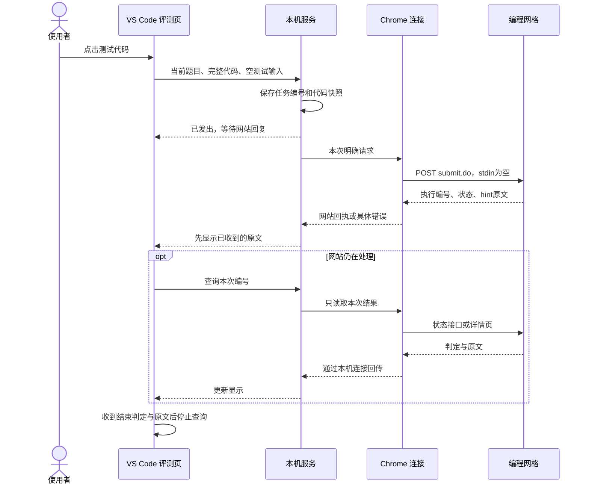

# 编程网格适配：架构与数据流

本工具把“运行与判题”和“AI 学习辅助”分成两个入口。前者由编程网格返回真实结果；后者根据题目、代码及已保存证据提供学习建议。

## 组件职责

| 组件 | 负责什么 | 主要文件 |
| --- | --- | --- |
| VS Code 扩展 | 读取当前 C++ 缓冲区，提供按钮、题面及两个独立页面 | `vscode-extension/extension.cjs`、`judge-window.html`、`judge-controls.js` |
| 本机服务 | 校验题目关联、保存请求和结果、快速返回任务状态 | `src/vscode-host.js`、`src/vscode-service.js` |
| 本机浏览器连接 | 在本机文件信箱与 Chrome Native Messaging 之间转发 | `src/browser-mailbox.js`、`src/oj-native-host.js`、`native/launcher.cpp` |
| Chrome 扩展 | 找到同一道题的 IDE 标签，以已登录会话调用网站 | `extension/grid-worker.js`、`extension/grid-submit.js` |
| 编程网格 | 编译、执行、判题并提供原文 | 网站的 `submit.do`、`solution/<编号>/status.do` 与详情页 |
| 分析进程 | 保存学习过程，生成提示、交流答复及报告 | `src/hint-review.js`、`src/model-runner.js` 等 |

“本机程序”像中转站：VS Code 不能直接使用 Chrome 的登录会话，Chrome 也不能任意读取 VS Code 的未保存代码。中转站把用户本次明确点击的代码和题目地址送到浏览器，再将网站回复带回来。

## 一次测试怎样运行

本机保存和后台报告处理不阻挡已收到的原文。查询结果只针对原请求的编号和快照；编辑器后来修改代码，不会改变旧任务所代表的代码。

## 空字段与缺省字段的差别

同一个接口可以通过参数表达不同操作。当前网站行为由网页脚本和使用者在 Network 中提供的真实表单共同核对：

| 操作 | `sourceCode` | `programLanguage` | `type` | `stdin` |
| --- | --- | --- | --- | --- |
| 网页原生测试 | 本次代码 | `C++` | `json` | 存在，值为空 |
| 手工输入测试 | 本次代码 | `C++` | `json` | 存在，值为自定义输入 |
| 正式提交 | 本次代码 | `C++` | `json` | 不发送 |

空值表示“这个字段存在，但没有自定义输入”；缺省表示“这次请求没有这个字段”。两者不能合并处理。之前自动把题目样例填入测试请求，使默认测试变成手工运行；现在默认始终发送空字段，只有用户启用可选手工模式才发送输入框内容。

## 原文、状态和结束条件

- 执行编号是网站返回的字符串，实际出现过 32 位十六进制编号；只校验它是安全的地址片段，不假定纯数字。
- 网站 `hint` 是 IDE 输出与提示的主要原文。界面保留换行，不拆造网站没有单独给出的标准答案或用例。
- 外层 `Processing` 表示仍在处理。`Testing` 可能是已经完成的测试类型；若原文有 `Result: WrongAnswer` 等明确判定，按该判定显示。手工运行的 `Complete! Please check the output by yourself` 只表示执行结束。
- 完整名称与颜色显示在原文上方。Empty Output 等具体网站状态保留其含义，不强行统一显示为 WA 缩写。
- 详情页可以补充反馈。已经收到结束判定与原文时，不为了补读详情页反复刷新；较慢的状态接口也不会挡住已返回的详情原文。
- 当前操作最多进行有限次数的结果查询；查询暂停后可主动刷新。恢复历史只读本机记录，不重新启动网站查询。
- 原始接口 JSON 仍可保存在本机记录，用户页面只呈现网站原文、判定和必要提示。

旧版本留下的 `Testing + pending` 记录，在已有完成原文时会在本机改正状态。这个修正不重新上传代码。

## 失败时发生什么

浏览器请求在注入脚本内部捕获异常，并作为可序列化数据返回。这样可以避免脚本 Promise 失败后，Chrome 只留下一个没有结果的执行记录。回传可包含失败阶段、错误文字及已收到的原文。

本机连接记录“已转发”“Chrome 已接收”“已找到题目标签”“等待网站接口”等阶段；文件通知之外另有定期扫描，减少漏收请求。网站接口等待有期限，超时后保留不确定状态，不自动重复发送。明确在发送前发现题目不匹配时，显示未发送。

“已建立连接”不等于网站已经处理请求；“首次回复”也不等于最终评测完成。排查时先看当前题目和本次编号，再看网站原文和失败阶段。

## 与 AI 服务的关系

评测页不调用模型来决定 AC/WA。提示与交流在另一个页面展示，由本机分析进程根据题目、代码快照及已保存证据调用使用者自己的模型服务。提示侧重算法概念、结构、下一步方向和可学习的工具或函数；完整参考解答有独立入口。

## 本机数据与 Git 协作

任务保存到 `data/grid-tests/`、`data/oj-submissions/`，上下文、题目时间线、提示与报告分目录保存。`data/`、`archives/`、`reports/`、本机路径和连接配置均不发布到 GitHub。

GitHub 里的代码描述“工具如何工作”，本机数据记录“使用者实际做过什么”。其他同学克隆仓库后得到相同工具，但需要安装自己的连接、登录自己的账号，并维护自己的数据。

## 验证范围

针对网格的 14 项检查覆盖请求参数、原文保留、完整判定名称、编号、异常回传、停止查询、恢复旧记录、状态栏与本机连接。模拟检查不使用个人账号、不调用真实模型、不向网站提交作业。

使用者在真实网站核对过请求表单与回传；网站布局、登录状态和服务负载仍可能影响结果。适配目标是 Windows 桌面 VS Code 与 Chrome，当前读代码操作以 C++ 文档为入口，不保证其他语言、站点别名和远程环境的完整行为。

## 模型和样式配置如何传递（0.2.9）

模型选择/插件设置 → VS Code 用户配置 → configure_ai 本机消息 → 私有 data/coach-model-settings.json → 工作进程每次请求开始读取 → 同一会话和生成使用相同模型与强度。

默认 Luna / low，原先报告的 Sol / xhigh 也统一替换。预热会话记录模型和强度，配置改变后不用旧预热会话发新请求；正在生成的请求继续使用原配置。不自动换模型重试。

判定外观走另一条链路：用户设置 → judge_settings 页面消息 → 大字头文本和样式。颜色只接受十六进制、字号限制 0–200 px、文字通过 textContent 显示；网站原文及评测状态均保持不变。修改设置只重画标题，不触发提交或刷新。
